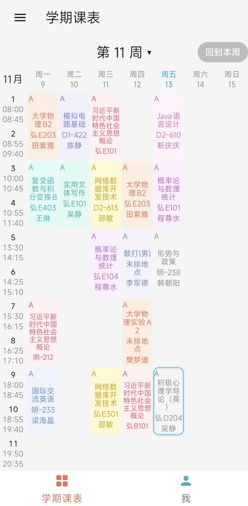
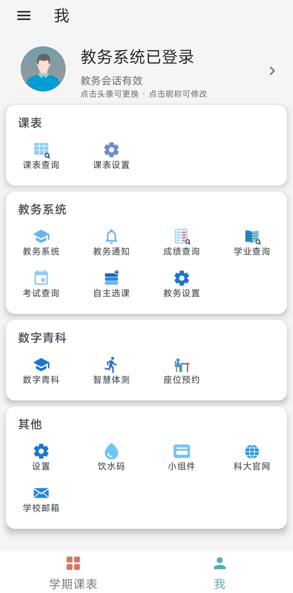

# 青科助手
**当前维护版本：红米版 v3.6.0256 · 普适版 v3.6.0257**（APK 下载见 [Releases](https://github.com/zhangzhenzyc/QUST-Assistant-mod/releases)）· 版本历史见 [CHANGELOG.md](CHANGELOG.md)

<p align="center">
  
</p>

<div align="center">

✨ 一款集教务查询和课表管理于一体的移动端软件 ✨
</div>

---

## 项目简介

- Qust Helper 是一款移动端教务系统客户端，旨在为师生提供一个便捷的教务访问方式，随时随地查看课程安排、考试成绩、教务通知等信息。
- Qust Helper 还是一款优秀的课表软件，能够轻松从教务导入课程信息，自动生成个性化的课表。
- 基于全新的 Jetpack Compose 架构，拥有更加出色的用户体验。

## 原项目来源与修改范围

- **原项目**：[QUST-Assistant（青科助手）](https://github.com/2891954521/QUST-Assistant)，原作者 **2891954521**，以 **GPL-3.0** 开源。
- **本项目**：基于原项目修改而成的「青科助手（修改版）」，维护者为 [zhangzhenzyc](https://github.com/zhangzhenzyc)。
- **修改范围**：登录流程修复与优化、课表编辑与时间表管理增强、桌面小组件（本周课表/今日课表/饮水码）多项修复、界面细节调整等；详见软件内「设置 → 关于 → 修改说明」与 [CHANGELOG.md](CHANGELOG.md)。
- **版权与许可区分说明**：本项目原始开源许可与原作者版权声明保持原样（见 [LICENSE](LICENSE)）；修改版附加版权声明见 [NOTICE.md](NOTICE.md)，独立存在、不替代不削弱原始许可的法律效力，两份版权声明同时生效。

## 软件截图

<p align="center">
  
  &nbsp;&nbsp;
  
</p>

（左：学期课表页；右：「我」页 —— 实机截图）

## 安装

- **直接安装**：从 [Releases](https://github.com/zhangzhenzyc/QUST-Assistant-mod/releases) 下载最新的 APK 文件，安装到 Android 8.0（API 26）及以上的手机即可。
- **安全提示**：请仅从本仓库 Releases 页面下载安装包；安装时系统如提示"未知来源应用"，请确认来源后再继续。

## 编译步骤

1. 准备环境：
   - JDK 17
   - Android SDK（compileSdk 34 / minSdk 21 / targetSdk 34）
   - Android Studio（Koala 及以上）或命令行 Gradle 8.10.2
2. 克隆本仓库：
   ```bash
   git clone https://github.com/zhangzhenzyc/QUST-Assistant-mod.git
   cd QUST-Assistant-mod
   ```
3. 编译 Debug 包：
   ```bash
   ./gradlew :app:assembleDebug
   ```
   编译 Release 包（需要自行配置签名）：
   ```bash
   ./gradlew :app:assembleRelease
   ```
4. 运行单元测试：
   ```bash
   ./gradlew :app:testReleaseUnitTest
   ```

## 使用说明

1. 首次打开软件，按引导登录教务系统（支持「教务系统原网址」与「数字青科」两条通道）。
2. 登录成功后自动查询并导入课表；课表支持编辑、调休、多套时间表管理等。
3. 「设置 → 桌面小组件」可添加本周课表、今日课表、饮水码桌面小组件。
4. 「我」页可进入成绩查询、学业情况、考试查询、各网页入口等功能。
5. 首次登录页需勾选同意《免责声明》《用户协议》与《隐私政策》后方可登录：隐私政策与用户协议均沿用原作者/原版软件内容，未做修改（见 [NOTICE.md](NOTICE.md)「沿用隐私政策与用户协议说明」）。
6. 遇到显示异常时，可在「设置 → 关于 → 修改说明」了解本版本改动，并通过 [CONTRIBUTING.md](CONTRIBUTING.md) 中的渠道反馈问题。

## 功能实现

- ✔ 教务课表导入
- ✔ 成绩查询
- ✔ 学业情况查询
- ✔ 考试查询
- ✔ 教务通知推送
- ✔ 成绩推送

## 开源许可

本项目基于原项目 [QUST-Assistant](https://github.com/2891954521/QUST-Assistant) 修改而成，遵循 **GPL-3.0** 开源：

- 原始许可原文与原作者版权声明：见 [LICENSE](LICENSE)（保持原样，未做修改）。
- 修改版附加版权声明：见 [NOTICE.md](NOTICE.md)（独立声明，不替代、不削弱原始许可的法律效力）。
